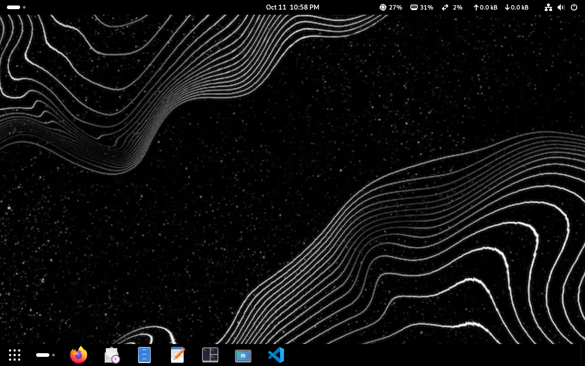
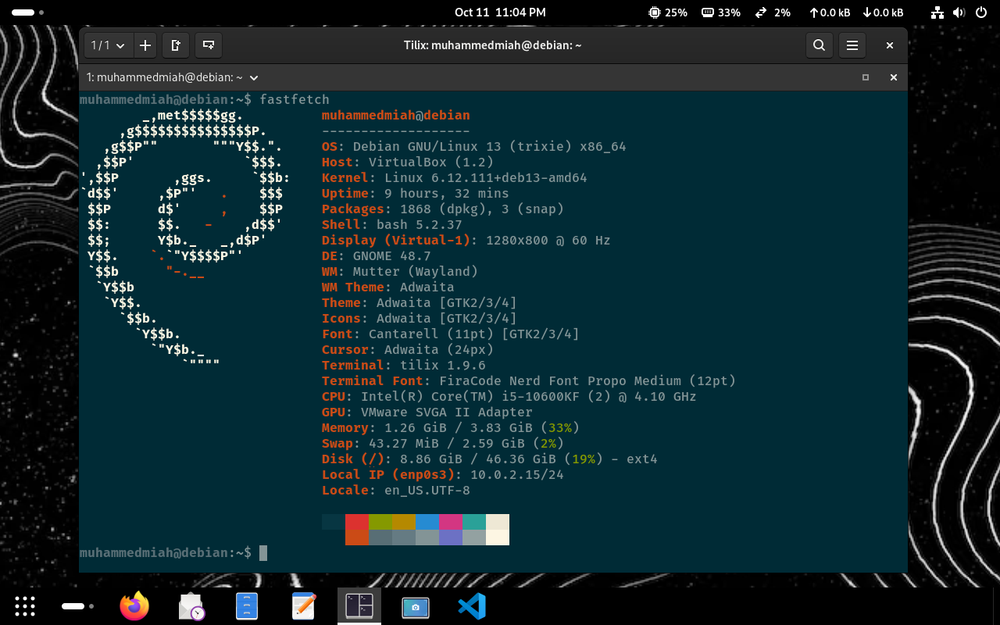
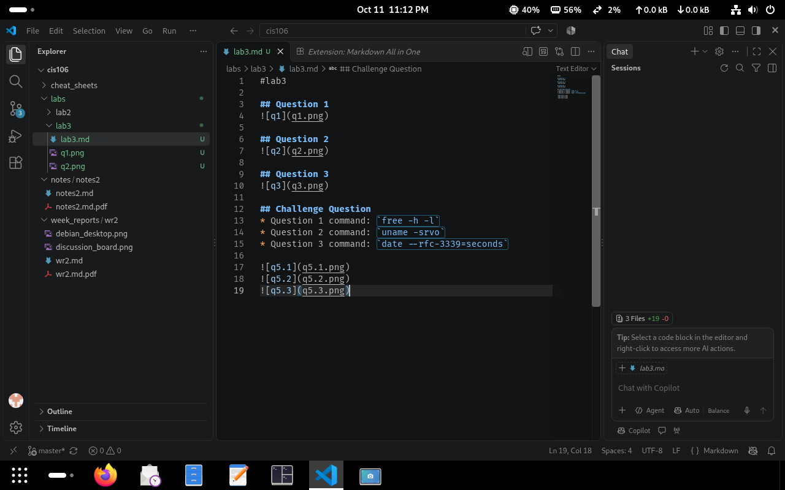

#lab3
 
## Question 1

 
## Question 2

 
## Question 3

 
## Challenge Question
* Question 1 command: `free -h -l`
* Question 2 command: `uname -srvo`
* Question 3 command: `date --rfc-3339=seconds`
 

