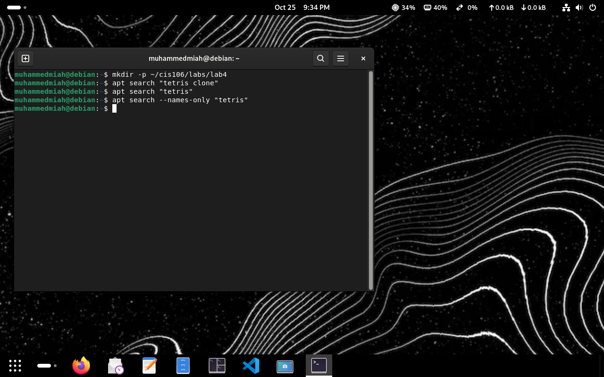
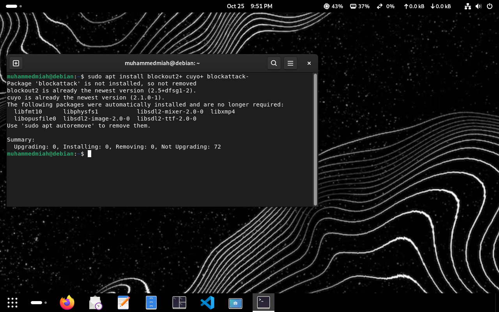
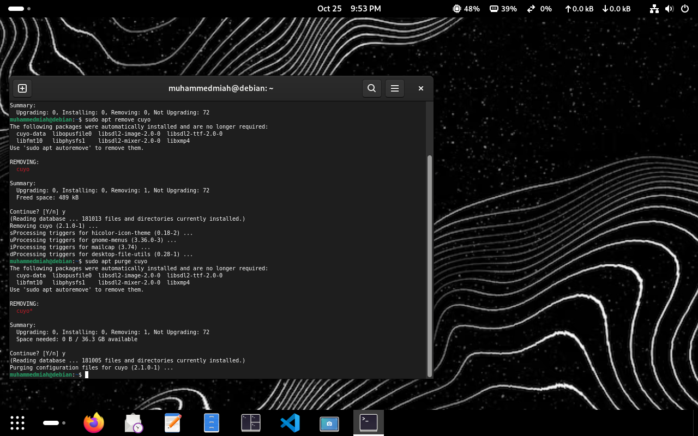
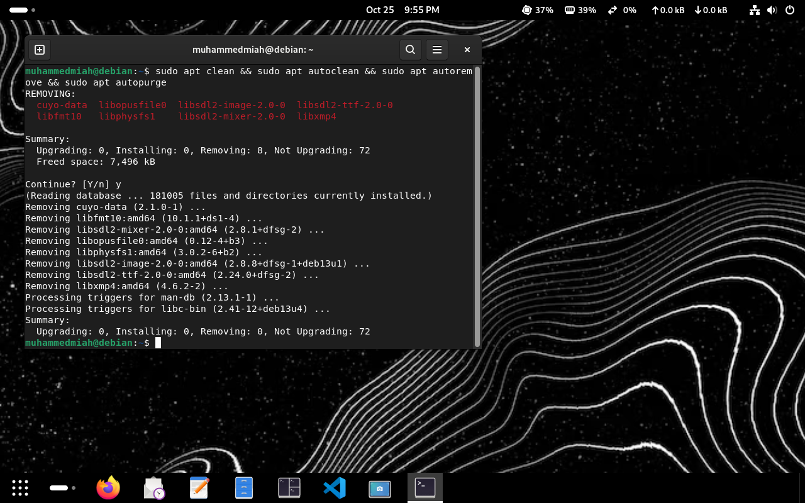
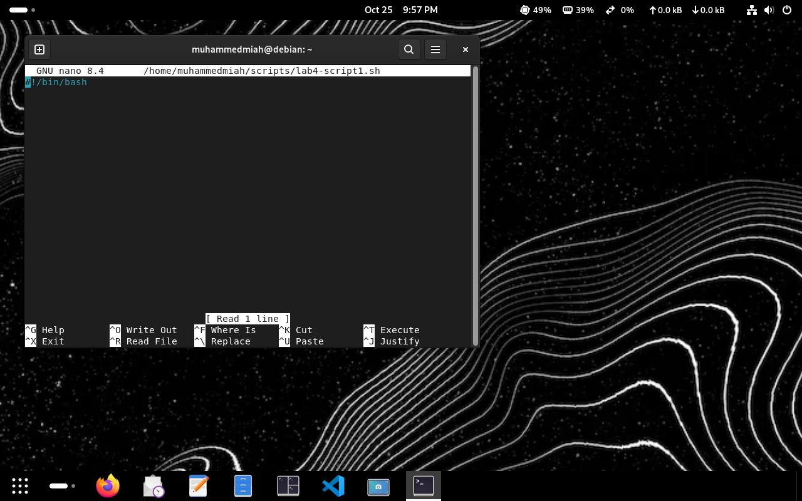
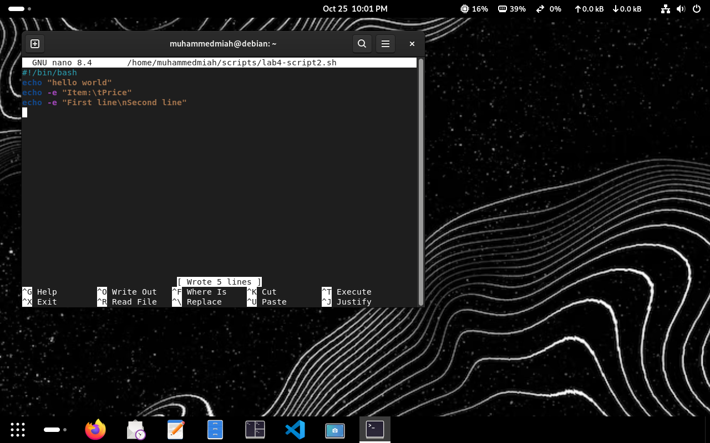
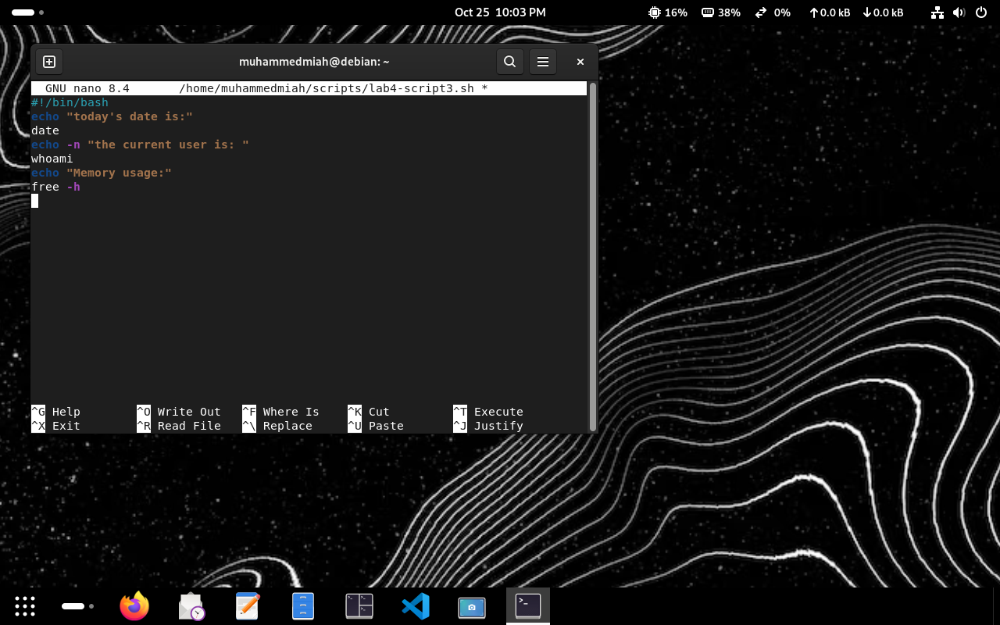
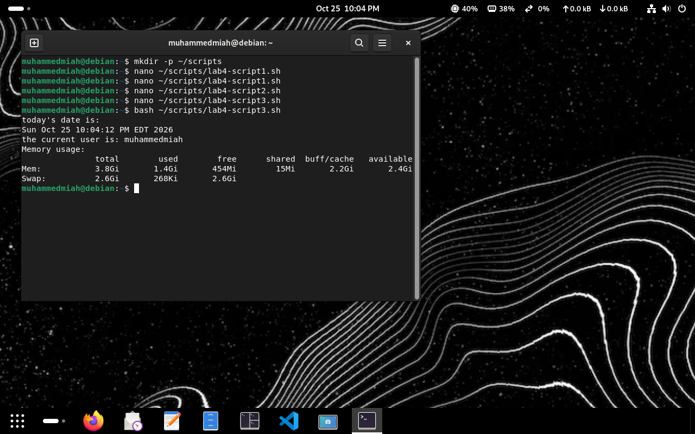
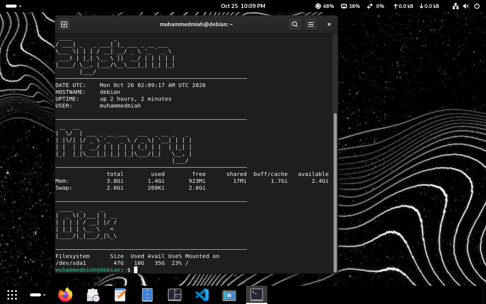

# Lab 4 Report

## Question 1: Using APT

### Q1.1: Searching Packages

### Q1.2: Installing and Removing Packages with + and - 

### Q1.3: Removing and Purging Cuyo 

### Q1.4: System Cleaning 

## Question 2: Shell Scripting

### Q2.1: First Script ("Lab4-script1.sh')

### Q2.2: Printing Text ("lab4-script2.sh')

##02.3: Script Text Editor (lab4-script3.sh)

### Q2.4: Script Terminal Output ("Lab4-script3.sh")

## Question 3: Challenge Script

### Q3.1: Challenge Script Text Editor ('challenge_lab4.sh")

### Q3.2: Challenge Script Terminal Output 

