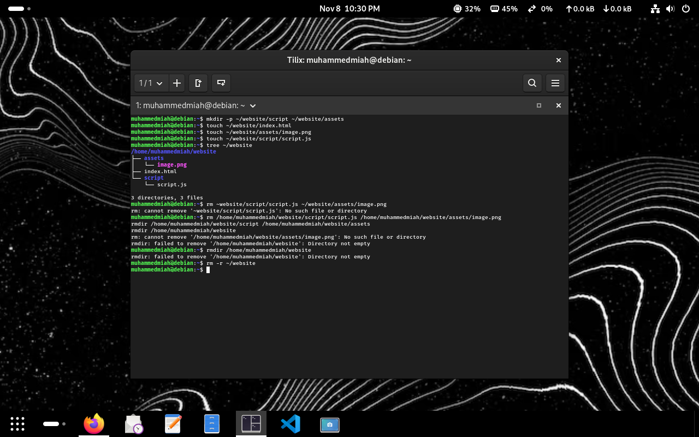
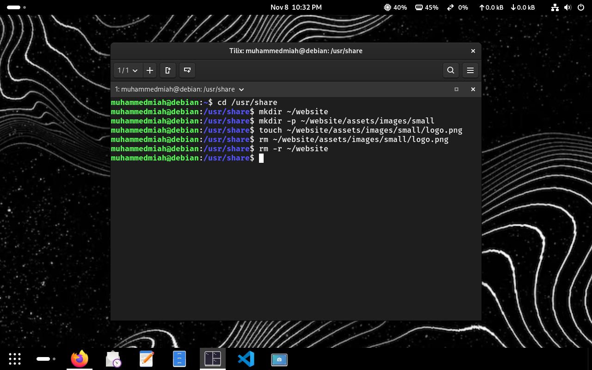
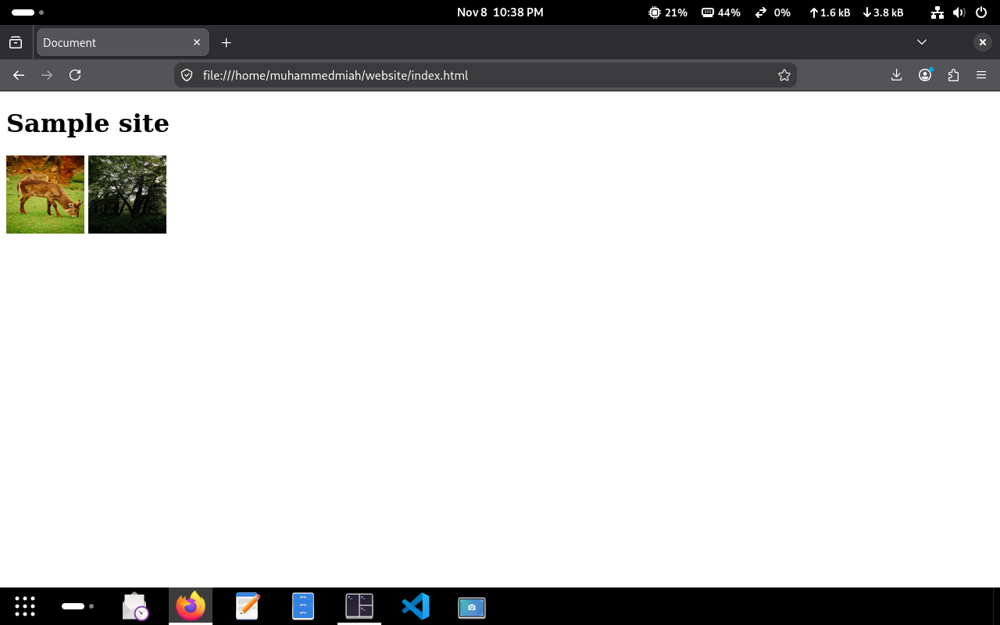
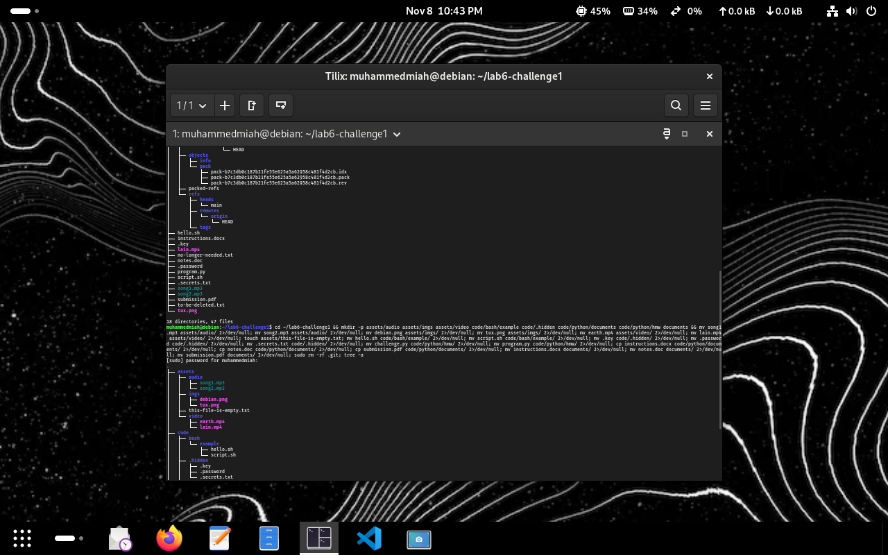
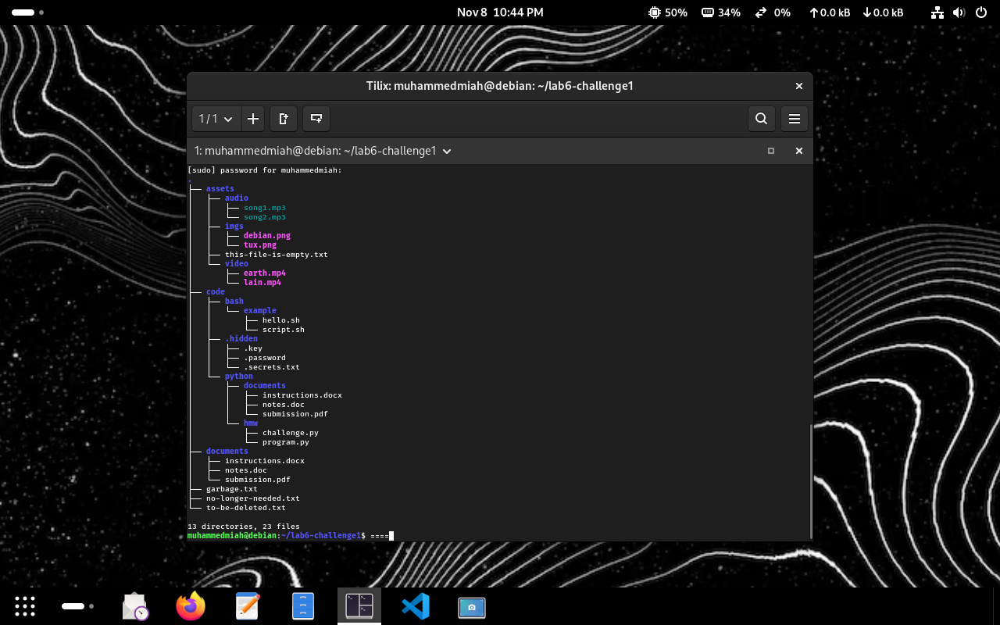
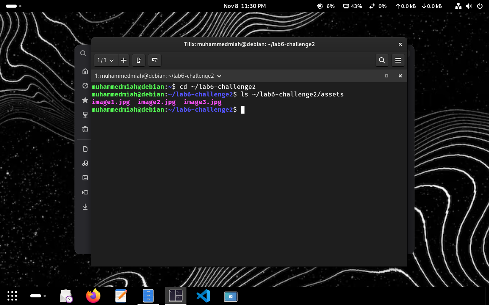
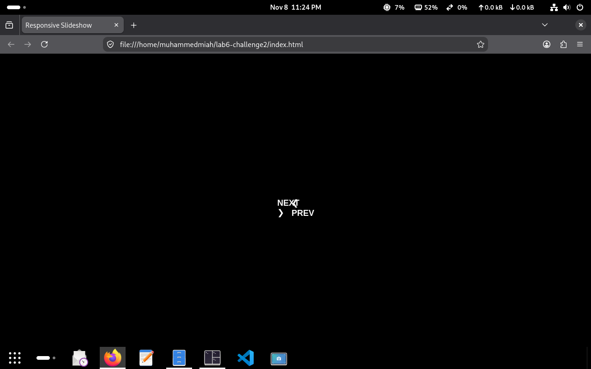

# lab 6 submission

## practice 1

## practice 2

## practice 3

## challenge question 1
### commands

### directory tree output

## challenge question 2
### image transfer commands

### webpage display
