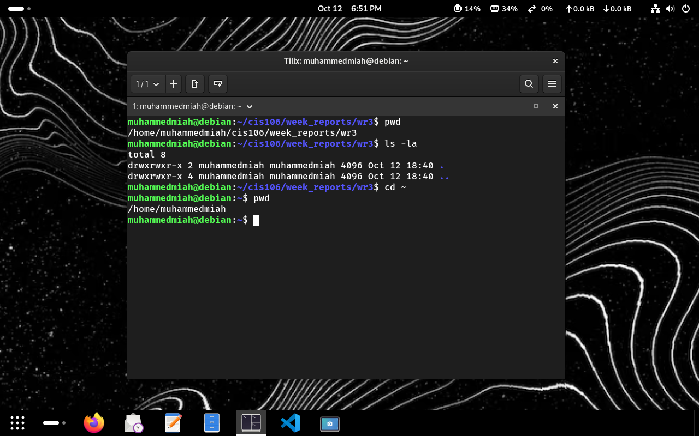
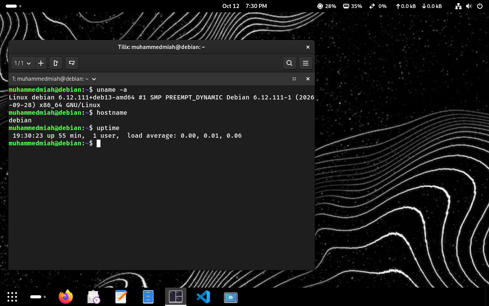
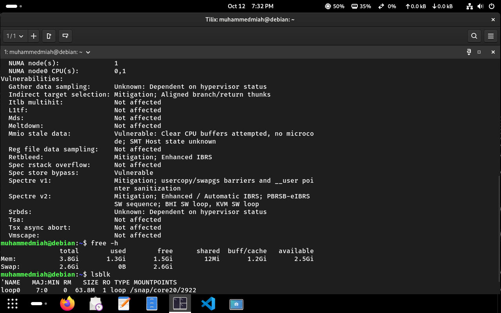
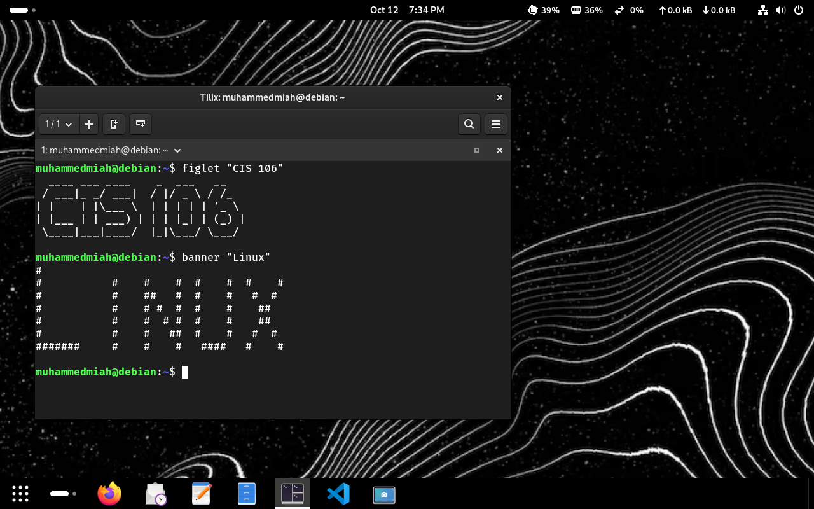
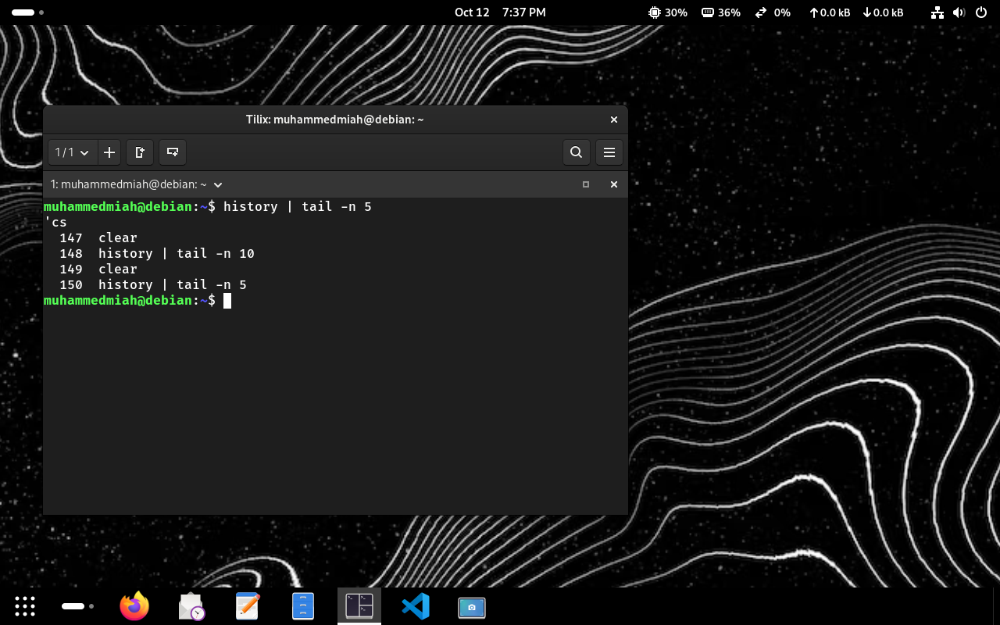
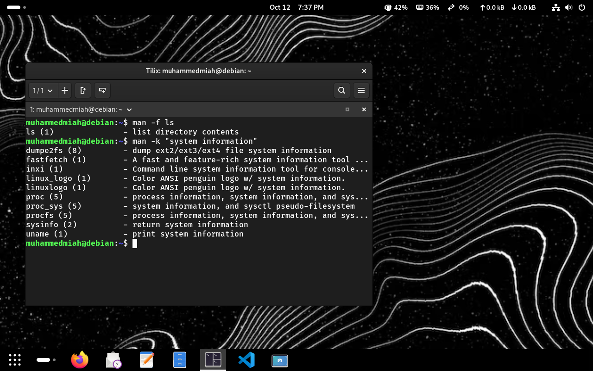
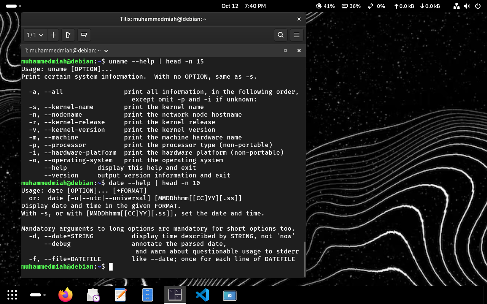
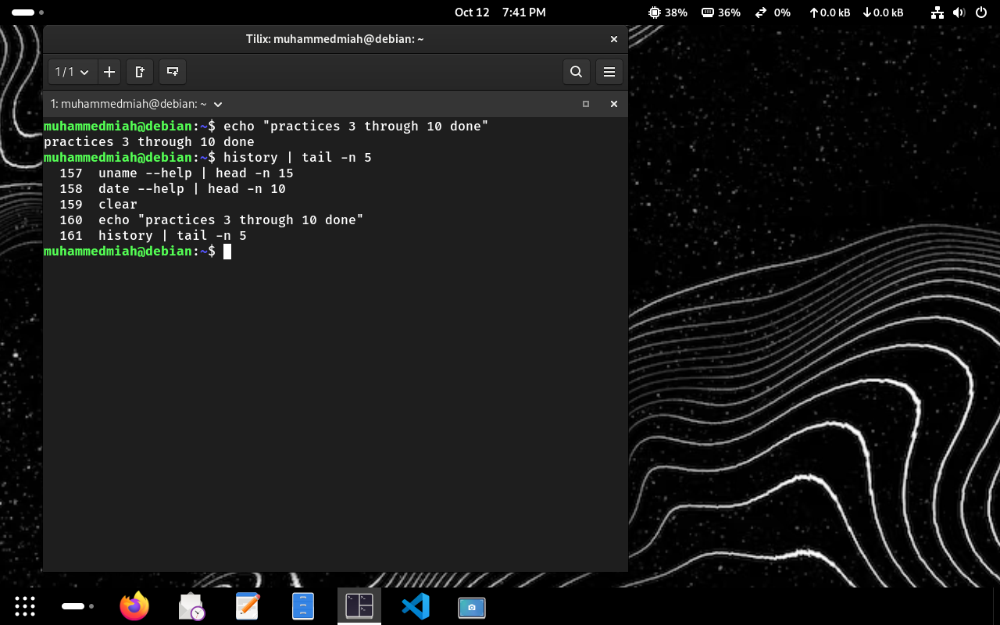

# Week Report 3
 
* **Course:** CIS 106
* **Semester:** Fall 2026
* **Lab Notes:** [Notes 3](../../notes/notes3/notes3.md)
 
---
 
## Lab Deliverables
 
### Practice 3: Navigating the GNOME GUI

 
### Practice 4: Terminal Customization & Navigation

 
### Practice 5: System Information Commands

 
### Practice 6: System Resource Commands

 
### Practice 7: Command History

 
### Practice 8: Using man Pages

 
### Practice 9: Using --help

 
### Practice 10: Final Review & Summary

 
---
 
## Conclusion
In this lab, I learned how to navigate the GNOME desktop environment and use essential Linux command-line tools. I practiced checking system info with commands like `uname`, `free`, and `df`, as well as using command history, `man` pages, and `--help` flags to quickly learn how commands work.