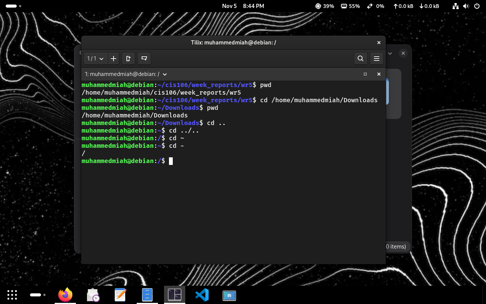
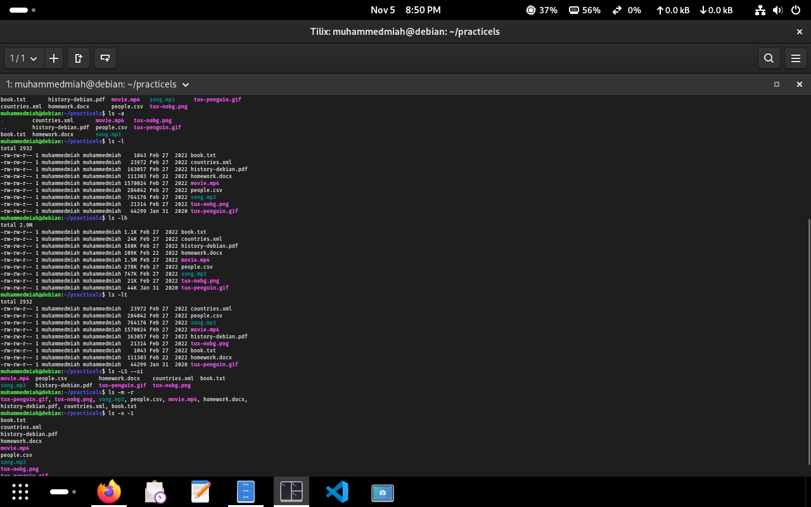
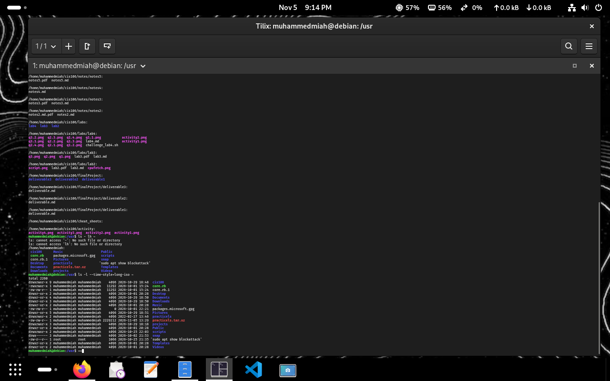
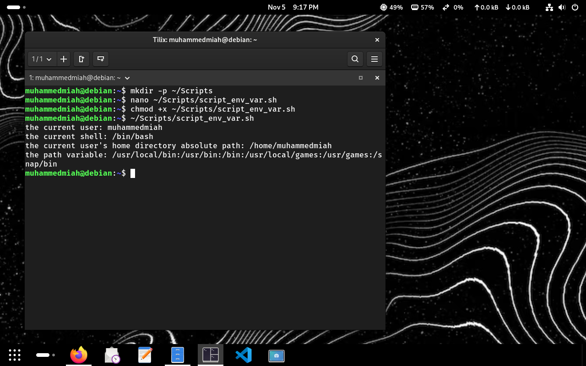
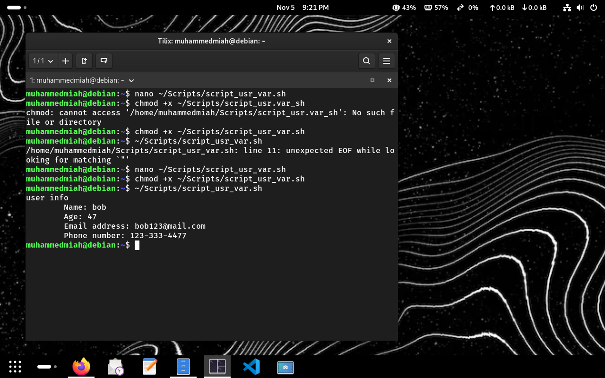

# week report 5
 
## links & references
- **notes:** [notes 5](https://github.com/muhammedsmiah1-art/cis106/blob/master/notes/notes5/notes5.md)
- **lab report:** [lab 5](https://github.com/muhammedsmiah1-art/cis106/blob/master/labs/lab5/lab5.md)
 
## practice exercises screenshots
 
### linux practice

 
### shell practice

